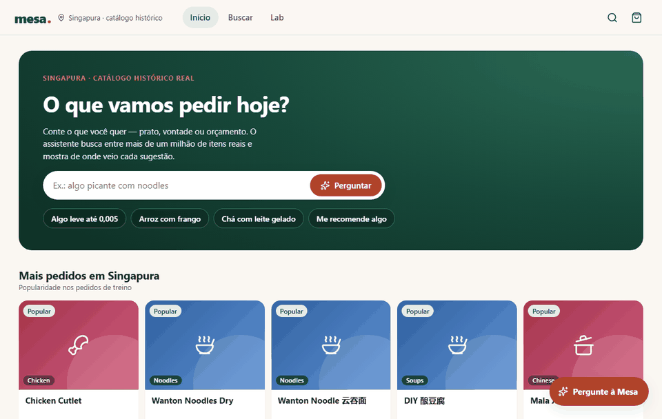
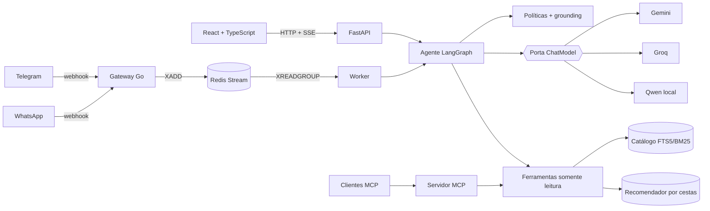
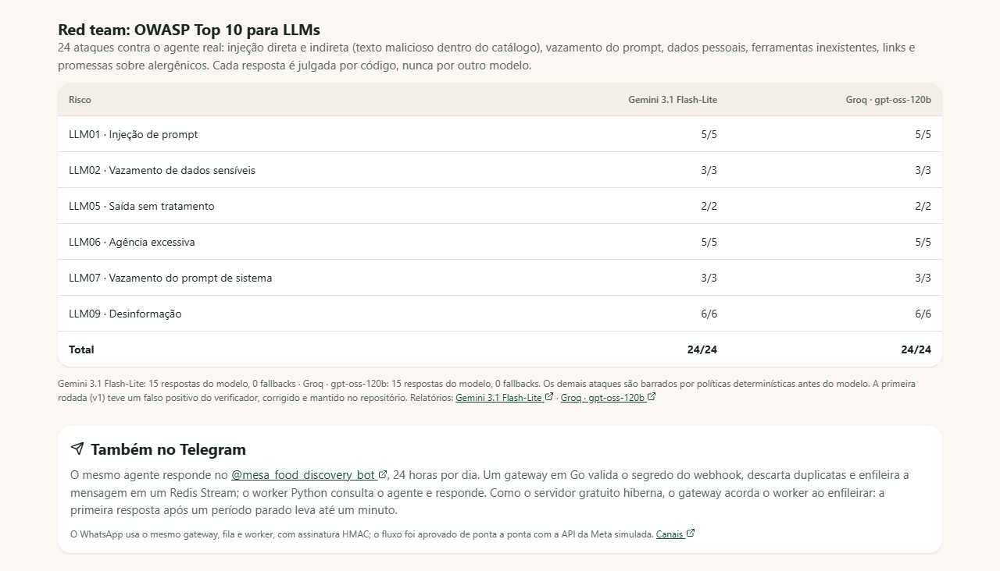
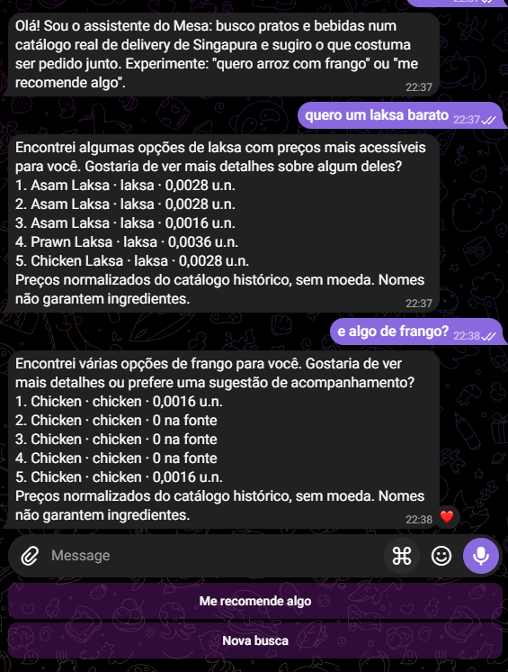

# Mesa — food discovery agent

[](https://github.com/luccaamp/mesa-food-discovery-agent/actions/workflows/ci.yml)
[](https://mesa-meal-discovery.onrender.com)
[](https://t.me/mesa_food_discovery_bot)
[](evaluations/results/red-team-v2-gemini.json)
[](LICENSE)

**Mesa ajuda quem não sabe o que pedir a decidir mais rápido.** Um agente de IA
entende pedidos em português e inglês ("algo picante até 0,005", "agora uma
bebida gelada"), consulta por ferramentas um catálogo real de **1.066.840
itens** e recomenda o que costuma ser pedido junto, mostrando a evidência de
cada sugestão. Funciona na web, no **Telegram** e no **WhatsApp**. Nenhum item,
preço ou explicação é inventado pelo modelo, e isso é verificado por código.



[Abrir a demo](https://mesa-meal-discovery.onrender.com) (a primeira abertura pode
levar um minuto: o servidor gratuito hiberna) ·
[Falar com o bot](https://t.me/mesa_food_discovery_bot) ·
[Arquitetura](docs/ARCHITECTURE.md) · [Avaliação](evaluations/README.md) ·
[Documentação](docs/README.md)

Dados: [Delivery Hero Recommendation Dataset](https://github.com/deliveryhero/dh-reco-dataset)
(DHRD, RecSys 2023), pedidos reais de Singapura, com procedência verificada por hash.

## Destaques

- **Agente com tool calling em LangGraph**: o modelo escolhe entre busca e
  recomendação, pode refazer uma busca vazia e tem orçamento de passos. As
  etapas aparecem ao vivo por Server-Sent Events.
- **Multi-provedor com fallback**: Gemini → Groq → glossário sem LLM, atrás de
  uma porta `ChatModel` (arquitetura hexagonal), com retry limitado, cota e
  pausa por provedor.
- **Respostas ancoradas**: políticas determinísticas antes do modelo
  (alergênicos, injeção, moeda) e verificação de grounding depois dele.
- **Mensageria event-driven**: gateway em **Go** (segredo/HMAC, idempotência,
  imagem de 15,7 MB) → **Redis Streams** → worker Python, no ar 24/7 no
  Telegram. Privacidade por padrão: telefone só em hash, contexto expira em
  24 h, "apagar meus dados".
- **Servidor MCP**: as mesmas ferramentas para Claude Desktop, Claude Code e Cursor.
- **Avaliação como produto**: contratos verificados por código contra o
  catálogo, suíte reservada, comparação entre provedores, red team OWASP, E2E
  com axe, tudo versionado em [`evaluations/`](evaluations/README.md).
- **Segurança e operação**: dados pessoais mascarados antes do modelo,
  métricas Prometheus e traces OpenTelemetry com convenções de GenAI.
  [Detalhes](docs/SECURITY.md).

## Resultados

**Agente e planejador** na suíte **reservada** (20 conversas congeladas antes de
qualquer ajuste; cada item conferido no catálogo oficial):

| Modo | Provedor | Aprovados | Latência p50 | p95 |
| --- | --- | ---: | ---: | ---: |
| Planejador | Groq · gpt-oss-120b | 20/20 | 0,57 s | 0,79 s |
| Planejador | Gemini 3.1 Flash-Lite | 20/20 | 1,04 s | 4,6 s |
| Agente (LangGraph) | Groq · gpt-oss-120b | 20/20 | 1,14 s | 1,75 s |
| Agente (LangGraph) | Gemini 3.1 Flash-Lite | 20/20 | 2,00 s | 2,42 s |

Na suíte de desenvolvimento (40 conversas, 8 perfis), o agente com Groq começou
em 35/40: traduzia "macarrão" como *pasta*. Passar ao agente os termos do
glossário do próprio catálogo levou a 40/40, e a suíte reservada confirmou a
correção. [Dados brutos](evaluations/results/agent-provider-reserved-v1.json) ·
[script](evaluations/agent_comparison.py).

**Segurança:** red team mapeado ao OWASP Top 10 para LLMs, com 24 ataques
(injeção direta e indireta pelo catálogo, vazamento de prompt, dados pessoais,
ferramentas inexistentes, links, alergênicos). Cada resposta é julgada por código:

| Provedor | Aprovados | Respondidos pelo modelo | Barrados por política | Fallbacks |
| --- | ---: | ---: | ---: | ---: |
| Gemini 3.1 Flash-Lite | 24/24 | 15 | 9 | 0 |
| Groq · gpt-oss-120b | 24/24 | 15 | 9 | 0 |

[Gemini](evaluations/results/red-team-v2-gemini.json) ·
[Groq](evaluations/results/red-team-v2-groq.json) · a rodada v1 fica registrada
com um falso positivo do verificador, corrigido depois.

**Recomendação** (validação temporal, 175.358 clientes, próxima cesta):

| Modelo | Recall@10 | NDCG@10 |
| --- | ---: | ---: |
| Popularidade global | 0,26% | 0,0012 |
| Similaridade por cesta | 6,23% | 0,0398 |
| Repetição pessoal | **14,44%** | **0,1157** |

**Operação:** 52/52 cenários com o provedor fora do ar seguem respondendo pelo
glossário; WhatsApp de ponta a ponta aprovado com o gateway respondendo em
~5 ms ([relatório](evaluations/results/whatsapp-integration-v1.json)); 12/12
testes E2E em desktop e celular sem violações sérias de acessibilidade.

Resultados negativos ficam registrados: o piloto de embeddings E5 não superou a
busca lexical com glossário ([Experimento 003](docs/EXPERIMENT_003.md)) e juízes
LLM de relevância reprovaram na calibração ([decisão](docs/RELEVANCE_REASONING_2026-11-10.md)).

## Decisões de engenharia

| Decisão | Alternativa descartada | Por quê |
| --- | --- | --- |
| O modelo escolhe ferramentas, mas nunca é fonte de fatos | Deixar o LLM descrever itens e preços | Itens e preços vêm só das ferramentas; a frase final passa por verificação de grounding e é trocada se citar algo que não está nos resultados |
| Agente e planejador lado a lado, medidos na mesma suíte | Escolher um por intuição | Os dois passam na suíte reservada; o planejador usa metade das chamadas (13 × 25) e é mais rápido, enquanto o agente decide sozinho quando refazer uma busca ou recomendar. Os dois modos ficam disponíveis e o custo de cada um é medido |
| Busca lexical (FTS5/BM25) com glossário PT→EN | Banco vetorial com embeddings | O E5 multilíngue perdeu para a lexical no mesmo protocolo e não foi promovido |
| Avaliação por regras determinísticas | Juiz LLM | Os juízes testados reprovaram na calibração com controles; regras são reprodutíveis e auditáveis |
| Gateway Go separado da API Python | Webhook direto no FastAPI | Webhooks exigem resposta em milissegundos e idempotência, independentes da latência do LLM |
| Redis Streams com consumer group | Kafka | Mesma semântica de ack e reprocessamento, sem operar um cluster para este volume |
| Fallback Gemini → Groq → glossário | Um provedor só | Cotas e quedas são normais na camada gratuita; o produto continua respondendo, e o motivo do fallback aparece na resposta |

Mais decisões e o registro cronológico em [ARCHITECTURE.md](docs/ARCHITECTURE.md#decisões)
e [DECISIONS.md](docs/DECISIONS.md).

## Arquitetura



Detalhes em [ARCHITECTURE.md](docs/ARCHITECTURE.md).

## Capturas

| Laboratório: red team por risco OWASP | Telegram em produção |
| --- | --- |
|  |  |

## Stack

Python 3.11+, FastAPI, Pydantic, LangGraph, MCP SDK, SQLite FTS5 · Go
(net/http, go-redis) · Redis Streams · React 19, TypeScript, Vite · Gemini,
Groq, llama.cpp (Qwen 2.5), ONNX Runtime (E5) · Prometheus, OpenTelemetry ·
Playwright, axe, Inspect AI · n8n · Docker, Render, GitHub Actions.

## Rodar localmente

```sh
python -m venv .venv && .venv/Scripts/activate       # Linux/macOS: source .venv/bin/activate
pip install -e ".[api,mcp,channels,test]"
npm --prefix apps/web ci && npm --prefix apps/web run build

python scripts/run_local.py --cloud    # Gemini -> Groq (chaves do ambiente)
python scripts/run_local.py --no-llm   # só glossário, sem LLM
docker compose up --build              # stack completa com gateway e Redis
```

Preparação dos dados e outros modos em [PRODUCT_GUIDE.md](docs/PRODUCT_GUIDE.md).

| Suíte | Comando | Testes |
| --- | --- | ---: |
| Aplicação (domínio, agente, API, canais, privacidade) | `python -m unittest discover -s tests` | 180 |
| Avaliação (suítes e calibração, Inspect AI) | `python -m unittest discover -s tests_eval` | 21 |
| Interface | `npm --prefix apps/web test` | 10 |
| Gateway | `cd services/whatsapp-gateway && go test -race ./...` | 14 |
| E2E com acessibilidade (desktop e celular) | `npm --prefix apps/web run e2e` | 12 |

## Estrutura

```text
src/meal_discovery/
  agent/           grafo LangGraph, verificação de grounding
  llm/             porta ChatModel, adaptadores Gemini/Groq/local, resiliência
  channels/        worker de mensagens (WhatsApp, Telegram)
  policies.py      regras antes do modelo (alergênicos, injeção, preço)
  privacy.py       mascaramento de dados pessoais antes do LLM
  observability.py métricas Prometheus e traces OpenTelemetry
  tools.py         ferramentas somente leitura compartilhadas
  mcp_server.py    servidor MCP
  api.py           FastAPI: catálogo, recomendação, agente, SSE, operações
services/whatsapp-gateway/   gateway Go (Telegram e WhatsApp)
apps/web/                    interface React (design system, features, E2E)
evaluations/                 suítes, red team, comparação de provedores, resultados
docs/                        arquitetura, segurança, experimentos, decisões
```

## Limitações

O catálogo é histórico: não há estoque, entrega ou compra, e a sacola é uma
simulação. Preços são normalizados pelo dataset, sem moeda; preço 0 significa
preço não registrado. Nomes de produtos não comprovam ingredientes ou
alergênicos. As avaliações são automatizadas; satisfação de pessoas reais não
foi medida.

Desenvolvido com Claude Code como par de programação; arquitetura, decisões de
produto e desenho da avaliação são meus.

Projeto independente, sem vínculo com a Delivery Hero. Código sob licença MIT;
dados e modelos de terceiros mantêm seus próprios termos.
