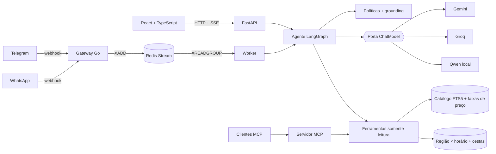

# Mesa: o que pedir quando você não sabe o que pedir

[](https://github.com/luccaamp/mesa-food-discovery-agent/actions/workflows/ci.yml)
[](https://mesa-meal-discovery.onrender.com)
[](https://t.me/mesa_food_discovery_bot)
[](evaluations/results/red-team-v2-gemini.json)
[](LICENSE)

Em um app de delivery, a tela inicial decide boa parte do pedido. Analisei
**1,7 milhão de pedidos reais** de 476 mil clientes de Singapura (dataset
público da Delivery Hero, RecSys 2023) para responder **o que mostrar para cada
pessoa**. Depois testei a resposta contra o próximo pedido real de cada cliente
e a coloquei num produto: web, Telegram e um agente de IA que busca no catálogo
por ferramentas, sem inventar itens nem preços.

[Abrir a demo](https://mesa-meal-discovery.onrender.com) (o servidor gratuito
pode levar um minuto para acordar) ·
[Falar com o bot](https://t.me/mesa_food_discovery_bot) ·
[Análise de negócio](docs/BUSINESS_ANALYSIS.md) ·
[Experimento](docs/EXPERIMENT_004.md) · [Arquitetura](docs/ARCHITECTURE.md)

## 1. O que os dados mostram

| Achado | Número |
| --- | --- |
| A maioria dos pedidos de quem já é cliente é **exploração** | **63%** vão para um restaurante que a pessoa nunca usou; 43% mesmo entre quem tem 10+ pedidos |
| **A popularidade é local** | O top-20 de cada região tem **0%** de sobreposição mediana com o top-20 da cidade |
| **O horário muda o que se pede** | Café sai 3,7× mais de manhã; noodles 3,0× de madrugada |
| **O cliente novo é frágil** | 58% não voltam em 30 dias, e o app não sabe nada sobre eles |
| **Item sem preço não vende** | 28% do catálogo sem preço, 0,9% dos pedidos |


Recomendar "peça de novo" atende a minoria dos pedidos. O sinal disponível para
todo mundo, inclusive para quem acabou de chegar, é **onde** e **quando** a
pessoa está pedindo. [Análise completa](docs/BUSINESS_ANALYSIS.md).

## 2. O teste: região e horário contra o próximo pedido real

Protocolo congelado antes de rodar ([config](configs/discovery-experiment-v1.json)),
escolha feita na validação e **uma única rodada no teste oficial do DHRD**
(171.515 clientes, dias 76–90). [Experimento 004](docs/EXPERIMENT_004.md).

| O restaurante do pedido real está entre os 10 mostrados? | Todos | Cliente novo |
| --- | ---: | ---: |
| Mais pedidos da cidade | 0,01% | 0,01% |
| Mais pedidos **da região, no horário** | 10,4% | **10,2%** |
| Ranker LightGBM (histórico + contexto) | **31,6%** | 9,0% |

| Itens do pedido real entre os 10 sugeridos (Recall@10) | Todos | Cliente novo |
| --- | ---: | ---: |
| Repetição + cidade (melhor modelo anterior) | 14,52% | 0,21% |
| **Repetição + região × horário** | **15,70%** | **2,88%** |

Para clientes novos, o contexto multiplica o acerto por 14 nos itens e leva o
restaurante de praticamente zero para 1 em 10. O ranker é o melhor no total,
mas perde para a regra simples justamente em quem não tem histórico. A decisão
é segmentar, e o trade-off de reservar posições para descoberta também foi medido.


## 3. O produto


- **Em alta perto de você, agora:** a home e o "me recomende algo" usam o
  modelo que venceu para quem não tem histórico (região × horário de Singapura).
- **Preço que uma pessoa entende:** o DHRD não publica moeda (o preço vai de
  0,0004 a 1,0 numa escala oculta). Cada item mostra sua faixa dentro da própria
  culinária ($, $$, $$$) e "mais barato que 72% dos itens de pizza". "Pizza
  barata" vira filtro. [Como funciona](docs/ARCHITECTURE.md#preço-em-faixas).
- **Agente com ferramentas (LangGraph):** entende português e inglês, escolhe
  entre busca e recomendação, refaz uma busca vazia, e nenhum item, preço ou
  frase sai sem verificação contra o catálogo. Gemini → Groq → glossário sem LLM.
- **Os mesmos dados em todo canal:** web (React), Telegram 24/7 via gateway Go
  e Redis Streams, WhatsApp pronto, servidor MCP para Claude, Cursor e IDEs.

## 4. Como sei que funciona

| Verificação | Resultado |
| --- | --- |
| Experimento de descoberta, teste oficial rodado uma vez | acima, com [dados brutos](evaluations/results/discovery-test-v1.json) |
| Agente na suíte reservada (20 conversas, cada item conferido) | 20/20 com Gemini e com Groq |
| Red team OWASP Top 10 para LLMs (24 ataques, julgados por código) | 24/24 com Gemini e com Groq |
| Provedor fora do ar | 52/52 cenários seguem respondendo pelo glossário |
| Testes automatizados | 196 backend · 21 avaliação · 11 interface · 14 Go · 12 E2E com axe |

Resultados negativos ficam registrados: embeddings E5 não superaram a busca
lexical ([Experimento 003](docs/EXPERIMENT_003.md)), e juízes LLM reprovaram na
calibração ([decisão](docs/RELEVANCE_REASONING_2026-11-10.md)).

## Decisões de engenharia

| Decisão | Alternativa descartada | Por quê |
| --- | --- | --- |
| Perguntar aos dados antes de escolher o modelo | Ir direto para um modelo mais sofisticado | A análise mostrou que o problema é descoberta e contexto, não recompra, e isso definiu o experimento |
| Regra região × horário para quem não tem histórico | Usar o ranker para todos | O ranker perde para a regra nesse segmento; servir cada um onde vence |
| Preço por posição dentro da culinária | Converter para moeda | A escala não é publicada; a posição vale para qualquer normalização que preserve a ordem |
| O modelo escolhe ferramentas, mas nunca é fonte de fatos | Deixar o LLM descrever itens e preços | Itens e preços vêm só das ferramentas, e a frase final passa por verificação de grounding |
| Busca lexical (FTS5/BM25) com glossário PT→EN | Banco vetorial | O E5 multilíngue perdeu no mesmo protocolo |
| Avaliação por regras determinísticas | Juiz LLM | Os juízes reprovaram na calibração; regras são reprodutíveis |
| Gateway Go + Redis Streams | Webhook direto no FastAPI | Webhooks exigem resposta em milissegundos e idempotência, independentes do LLM |

## Arquitetura



## Rodar

```sh
python -m venv .venv && .venv/Scripts/activate       # Linux/macOS: source .venv/bin/activate
pip install -e ".[api,mcp,channels,test]"
npm --prefix apps/web ci && npm --prefix apps/web run build
python scripts/run_local.py --cloud    # Gemini -> Groq (chaves do ambiente); --no-llm para só o glossário

pip install -e ".[analysis]"           # pandas, matplotlib, LightGBM
python analysis/business_analysis.py   # números e gráficos da análise
python analysis/discovery_experiment.py
```

Dados, deploy e outros modos em [PRODUCT_GUIDE.md](docs/PRODUCT_GUIDE.md);
índice de toda a documentação em [docs/](docs/README.md).

```text
analysis/            análise de negócio e Experimento 004 (protocolo em configs/)
src/meal_discovery/  agente, ferramentas, políticas, preço em faixas, região × horário, API, MCP
services/            gateway Go (Telegram e WhatsApp)
apps/web/            interface React com testes E2E e de acessibilidade
evaluations/         suítes, red team, comparação de provedores e todos os resultados
docs/                análise, experimentos, arquitetura, segurança
```

## Limitações

O catálogo é histórico: não há estoque, entrega ou compra. Os experimentos são
replays offline de pedidos reais: medem se o pedido teria aparecido, não
conversão ou satisfação. Nomes de produtos não comprovam ingredientes ou
alérgenos. Os nomes de bairro são uma aproximação do centro de cada região geohash.

Desenvolvido com Claude Code como par de programação; arquitetura, decisões de
produto e desenho da avaliação são meus.

Projeto independente, sem vínculo com a Delivery Hero. Código sob licença MIT;
dados e modelos de terceiros mantêm seus próprios termos.
