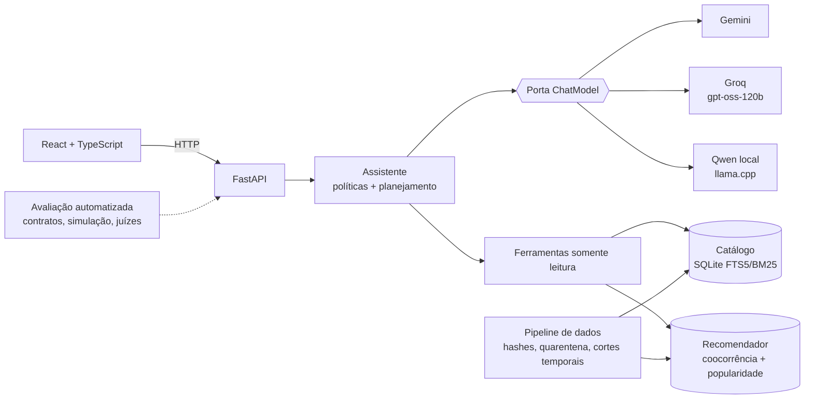

# Mesa — food discovery agent

[](https://github.com/luccaamp/mesa-food-discovery-agent/actions/workflows/ci.yml)
[](https://mesa-meal-discovery.onrender.com)

**Mesa ajuda quem não sabe o que pedir a decidir mais rápido.** Combina o
histórico real de pedidos, um catálogo de **1.066.840 produtos** e um assistente
com LLM que entende pedidos em português e inglês, consulta o catálogo por
ferramentas e mostra a evidência de cada sugestão. Nenhum item, preço ou
explicação é inventado pelo modelo.

Construído sobre o [Delivery Hero Recommendation Dataset](https://github.com/deliveryhero/dh-reco-dataset)
(DHRD, RecSys 2023), dados reais de Singapura: 4,4 milhões de pedidos nas três
cidades do dataset, com procedência verificada por hash.

[Abrir a demo](https://mesa-meal-discovery.onrender.com) (a primeira abertura
pode levar cerca de um minuto, porque o servidor gratuito hiberna) ·
[Arquitetura](docs/ARCHITECTURE.md) · [Avaliação](docs/AUTOMATED_EVALUATION.md) ·
[Roadmap](docs/ROADMAP.md) · [API](apps/api/README.md)

## O que ele faz

- **Busca conversacional:** "quero um café gelado até 0,005" vira uma busca no
  catálogo com filtro de preço; "agora chá com leite" troca o prato e mantém o filtro.
- **Recomendação:** a partir dos itens escolhidos, sugere o que costuma ser
  pedido junto em cestas reais, com fallback explícito para popularidade.
- **Evidência à vista:** cada card mostra de onde veio (busca, coocorrência em
  cestas ou popularidade) e os limites do dado histórico.
- **Guardrails:** recusa garantir alergênicos ou dieta, ignora instruções
  embutidas em mensagens e nunca converte o preço normalizado em moeda.

## Arquitetura



- **Hexagonal no núcleo de IA:** o assistente depende de uma porta `ChatModel`.
  Gemini, Groq, Qwen local e OpenAI são adaptadores intercambiáveis
  ([`src/meal_discovery/llm/`](src/meal_discovery/llm/)), com tool calling e
  saída estruturada no mesmo contrato.
- **Resiliência por provedor:** no máximo duas tentativas dentro de um
  orçamento de tempo, cota local, pausa após falhas seguidas e **fallback
  automático Gemini → Groq** antes de cair no glossário sem LLM.
- **Respostas ancoradas:** o LLM só escolhe uma ação permitida e palavras-chave;
  itens, preços e motivos vêm das ferramentas. Políticas determinísticas
  (restrição alimentar, injeção, moeda) rodam antes de qualquer modelo.
- **Dados com procedência:** ZIPs oficiais conferidos por SHA-256, pedidos
  inconsistentes em quarentena, treino até o dia 61 e teste oficial separado.

## Resultados

**Recomendação** (validação interna, 175.358 clientes, primeira cesta futura):

| Modelo | Recall@10 | NDCG@10 |
| --- | ---: | ---: |
| Popularidade global | 0,26% | 0,0012 |
| Similaridade por cesta | 6,23% | 0,0398 |
| Repetição pessoal | **14,44%** | **0,1157** |

**Assistente:**

| Avaliação | Resultado |
| --- | --- |
| Cenários de desenvolvimento (8 perfis × 3 repetições) | 120/120 |
| Contratos reservados, congelados antes da execução | 60/60 |
| Aceitação pública com Gemini real | 10/10, 36 itens conferidos no catálogo |
| Contingência com provedor fora do ar | 52/52 cenários, 282 itens conferidos |

Cada item citado é conferido por código contra o catálogo oficial. Os
resultados negativos ficam registrados: o piloto de embeddings E5 não superou
a busca lexical com glossário e não foi promovido
([Experimento 003](docs/EXPERIMENT_003.md)), e os juízes LLM de relevância não
passaram na calibração ([decisão](docs/RELEVANCE_REASONING_2026-11-10.md)).

## Stack

Python 3.11+, FastAPI, Pydantic, SQLite FTS5 · React, TypeScript, Vite ·
Gemini, Groq, llama.cpp (Qwen 2.5), ONNX Runtime (E5) · Inspect AI, n8n ·
Docker, Render, GitHub Actions.

## Rodar localmente

Pré-requisitos: Python 3.11+, Node 20+ e os artefatos de dados (o download é
automático no Docker; veja [o guia do produto](docs/PRODUCT_GUIDE.md)).

```sh
python -m venv .venv && .venv/Scripts/activate   # Linux/macOS: source .venv/bin/activate
pip install -e ".[api,test]"
npm --prefix apps/web ci && npm --prefix apps/web run build

python scripts/run_local.py --cloud    # Gemini -> Groq, chaves lidas do ambiente
python scripts/run_local.py            # Qwen local via llama.cpp
python scripts/run_local.py --no-llm   # só glossário, sem LLM
```

Abra http://127.0.0.1:8000. Com Docker: `docker build -t mesa . && docker run -p 10000:10000 -e GEMINI_API_KEY -e GROQ_API_KEY mesa`.

Testes:

```sh
python -m unittest discover -s tests          # aplicação
npm --prefix apps/web test                    # interface
```

## Estrutura

```text
src/meal_discovery/
  llm/            porta ChatModel, adaptadores, resiliência e roteamento entre provedores
  assistant.py    serviço do assistente: políticas, planejamento e ferramentas
  planner.py      planejamento de intenção com saída estruturada
  api.py          FastAPI: catálogo, recomendação, assistente e operações
  catalog.py      índice FTS5/BM25 do catálogo
  serving.py      recomendação por coocorrência e popularidade
  singapore.py    preparação dos dados oficiais
apps/web/         interface React/TypeScript
evaluations/      suítes de conversa, simulação de usuários e calibração de juízes
scripts/          preparação, verificação e execução
docs/             arquitetura, experimentos, decisões e roadmap
```

## Limitações

O catálogo é histórico: não há estoque, entrega ou compra. Preços são
normalizados pelo dataset, sem moeda. Nomes de produtos não comprovam
ingredientes ou alergênicos, e o Mesa não faz essa garantia. As avaliações são
automatizadas; satisfação de pessoas reais não foi medida.

Projeto independente, sem vínculo com a Delivery Hero. Código sob licença MIT;
dados e modelos de terceiros mantêm seus próprios termos.
