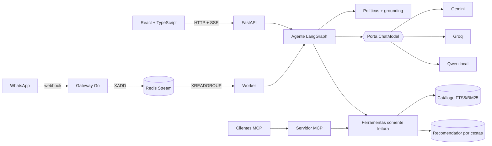

# Mesa — food discovery agent

[](https://github.com/luccaamp/mesa-food-discovery-agent/actions/workflows/ci.yml)
[](https://mesa-meal-discovery.onrender.com)

**Mesa ajuda quem não sabe o que pedir a decidir mais rápido.** Um agente de IA
entende pedidos em português e inglês ("algo picante até 0,005", "agora chá com
leite"), consulta por ferramentas um catálogo real de **1.066.840 itens** e
recomenda o que costuma ser pedido junto, mostrando a evidência de cada
sugestão. Funciona na web e no **WhatsApp**. Nenhum item, preço ou explicação
é inventado pelo modelo.

Dados: [Delivery Hero Recommendation Dataset](https://github.com/deliveryhero/dh-reco-dataset)
(DHRD, RecSys 2023), pedidos reais de Singapura, com procedência verificada por hash.

[Abrir a demo](https://mesa-meal-discovery.onrender.com) (a primeira abertura pode
levar um minuto: o servidor gratuito hiberna) · [Arquitetura](docs/ARCHITECTURE.md) ·
[WhatsApp](docs/WHATSAPP.md) · [MCP](docs/MCP.md) · [Avaliação](docs/AUTOMATED_EVALUATION.md)

## Destaques

- **Agente com tool calling em LangGraph**: o modelo escolhe entre busca e
  recomendação, pode refazer uma busca vazia e tem orçamento de passos. Etapas
  transmitidas ao vivo por Server-Sent Events.
- **Multi-provedor com fallback**: Gemini → Groq → glossário sem LLM, atrás de
  uma porta `ChatModel` (arquitetura hexagonal). Retry limitado, cota e pausa
  por provedor.
- **Respostas ancoradas**: políticas determinísticas antes do modelo
  (alergênicos, injeção, moeda) e verificação de grounding depois dele.
- **WhatsApp event-driven**: gateway em **Go** (HMAC, idempotência, 15,7 MB) →
  Redis Streams → worker Python. Privacidade por padrão: telefone só em hash,
  contexto expira em 24 h, "apagar meus dados".
- **Servidor MCP**: as mesmas ferramentas para Claude Desktop, Claude Code e Cursor.
- **Avaliação como produto**: contratos verificados por código contra o
  catálogo, suíte reservada, comparação entre provedores, E2E com axe.
- **Segurança e operação**: red team mapeado ao OWASP Top 10 para LLMs,
  dados pessoais mascarados antes do modelo, métricas Prometheus e traces
  OpenTelemetry com convenções de GenAI. [Detalhes](docs/SECURITY.md).

## Resultados

**Agente e planejador** na suíte **reservada** (20 conversas congeladas antes de
qualquer ajuste; cada item conferido no catálogo oficial):

| Modo | Provedor | Aprovados | Latência p50 | p95 |
| --- | --- | ---: | ---: | ---: |
| Planejador | Groq · gpt-oss-120b | 20/20 | 0,57 s | 0,79 s |
| Planejador | Gemini 3.1 Flash-Lite | 20/20 | 1,04 s | 4,6 s |
| Agente (LangGraph) | Groq · gpt-oss-120b | 20/20 | 1,14 s | 1,75 s |
| Agente (LangGraph) | Gemini 3.1 Flash-Lite | 20/20 | 2,00 s | 2,42 s |

Na suíte de desenvolvimento (40 conversas, 8 perfis), o agente com Groq começou
em 35/40: traduzia "macarrão" como *pasta*. Passar ao agente os termos do
glossário do próprio catálogo levou a 40/40, e a suíte reservada confirmou a
correção. [Dados brutos](evaluations/results/agent-provider-reserved-v1.json) ·
[script](evaluations/agent_comparison.py).

**Recomendação** (validação temporal, 175.358 clientes, próxima cesta):

| Modelo | Recall@10 | NDCG@10 |
| --- | ---: | ---: |
| Popularidade global | 0,26% | 0,0012 |
| Similaridade por cesta | 6,23% | 0,0398 |
| Repetição pessoal | **14,44%** | **0,1157** |

**Operação:** 52/52 cenários com o provedor fora do ar seguem respondendo pelo
glossário; WhatsApp de ponta a ponta aprovado com gateway respondendo em ~5 ms
([relatório](evaluations/results/whatsapp-integration-v1.json)); 12/12 testes
E2E em desktop e celular sem violações sérias de acessibilidade; red team
OWASP com 24 ataques: 24/24 no agente com Groq
([relatório](evaluations/results/red-team-v2-groq.json)).

Resultados negativos ficam registrados: o piloto de embeddings E5 não superou a
busca lexical com glossário ([Experimento 003](docs/EXPERIMENT_003.md)) e juízes
LLM de relevância reprovaram na calibração ([decisão](docs/RELEVANCE_REASONING_2026-11-10.md)).

## Arquitetura



Detalhes e decisões em [ARCHITECTURE.md](docs/ARCHITECTURE.md).

## Stack

Python 3.11+, FastAPI, Pydantic, LangGraph, MCP SDK, SQLite FTS5 · Go
(net/http, go-redis) · Redis Streams · React 19, TypeScript, Vite · Gemini,
Groq, llama.cpp (Qwen 2.5), ONNX Runtime (E5) · Playwright, axe, Inspect AI ·
Docker, Render, GitHub Actions.

## Rodar localmente

```sh
python -m venv .venv && .venv/Scripts/activate       # Linux/macOS: source .venv/bin/activate
pip install -e ".[api,mcp,channels,test]"
npm --prefix apps/web ci && npm --prefix apps/web run build

python scripts/run_local.py --cloud    # Gemini -> Groq (chaves do ambiente)
python scripts/run_local.py --no-llm   # só glossário, sem LLM
docker compose up --build              # stack completa com WhatsApp e Redis
```

Testes:

```sh
python -m unittest discover -s tests                  # aplicação (171)
npm --prefix apps/web test                            # interface (10)
(cd services/whatsapp-gateway && go test ./...)       # gateway (8)
npm --prefix apps/web run e2e                         # E2E, com o servidor no ar
```

## Estrutura

```text
src/meal_discovery/
  agent/          grafo LangGraph, verificação de grounding
  llm/            porta ChatModel, adaptadores Gemini/Groq/local, resiliência, roteamento
  channels/       worker do WhatsApp
  policies.py     regras antes do modelo (alergênicos, injeção, preço)
  privacy.py      mascaramento de dados pessoais antes do LLM
  observability.py métricas Prometheus e traces OpenTelemetry
  tools.py        ferramentas somente leitura compartilhadas
  mcp_server.py   servidor MCP
  api.py          FastAPI: catálogo, recomendação, agente, SSE, operações
services/whatsapp-gateway/   gateway Go
apps/web/                    interface React (design system, features, E2E)
evaluations/                 suítes, comparação de provedores, calibração
docs/                        arquitetura, decisões, experimentos, roadmap
```

## Limitações

O catálogo é histórico: não há estoque, entrega ou compra, e a sacola é uma
simulação. Preços são normalizados pelo dataset, sem moeda. Nomes de produtos
não comprovam ingredientes ou alergênicos. As avaliações são automatizadas;
satisfação de pessoas reais não foi medida.

Projeto independente, sem vínculo com a Delivery Hero. Código sob licença MIT;
dados e modelos de terceiros mantêm seus próprios termos.
