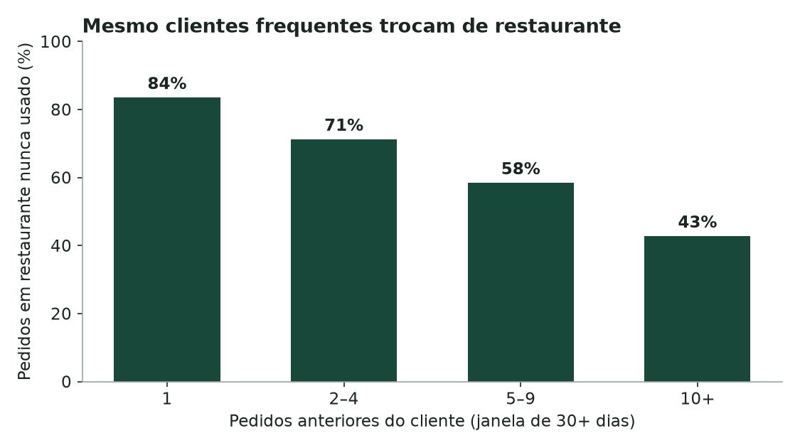
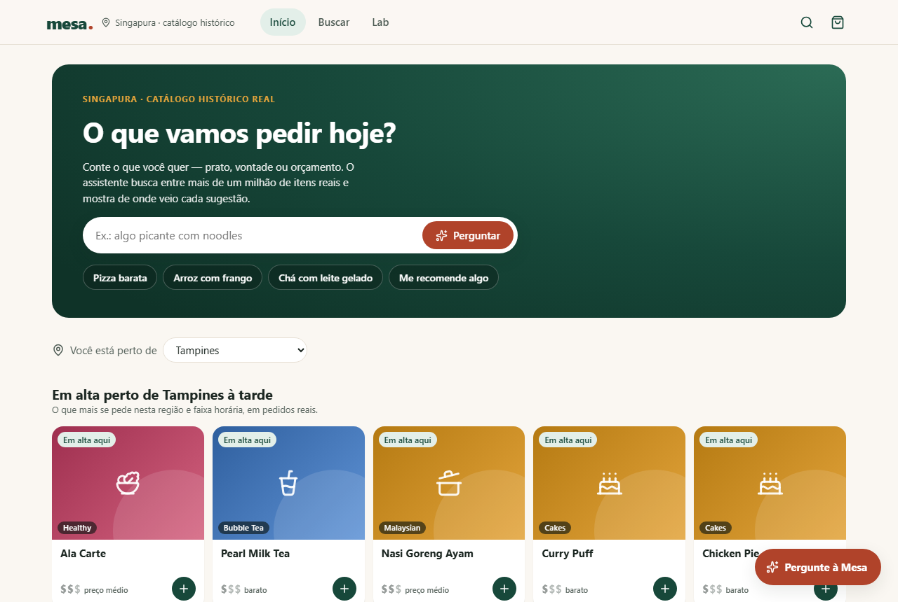

# Mesa: o que mostrar para quem não sabe o que pedir

[](https://github.com/luccaamp/mesa-food-discovery-agent/actions/workflows/ci.yml)
[](https://mesa-meal-discovery.onrender.com)
[](https://t.me/mesa_food_discovery_bot)
[](LICENSE)

Em um app de delivery, o que aparece na tela decide boa parte do pedido.
Estudei **1,7 milhão de pedidos reais** de 476 mil clientes de Singapura
(dataset público da Delivery Hero, RecSys 2023) para responder duas perguntas:

1. **O que mostrar a cada pessoa quando ela abre o app?**
2. **Um agente de IA que conversa ajuda a pessoa a achar o que ela de fato pede?**

As duas foram respondidas contra o próximo pedido real de cada cliente, no
teste oficial do dataset, com protocolo congelado antes de rodar. O que venceu
está no produto: [demo web](https://mesa-meal-discovery.onrender.com) (o
servidor gratuito pode levar um minuto para acordar) e
[bot no Telegram](https://t.me/mesa_food_discovery_bot).

## 1. O que os dados mostram

| Achado | Número |
| --- | --- |
| Quem já é cliente quase sempre **explora** | 63% dos pedidos vão para um restaurante que a pessoa nunca usou; 43% mesmo entre quem tem 10+ pedidos |
| A demanda é **local e sem campeões** | 68% dos pedidos são de restaurantes da própria região; os 10 mais pedidos da cidade somam só 0,37% dos pedidos e perderam a demanda ao longo do período |
| O **horário** muda o que se pede | Café sai 3,7× mais de manhã; noodles 3,0× de madrugada |
| O **cliente novo** é frágil | 58% não voltam em 30 dias, e o app não sabe nada sobre eles |



Recomendar "peça de novo" atende a minoria dos pedidos. O sinal disponível
para todos, inclusive para quem acabou de chegar, é **onde** e **quando**.
[Análise completa](docs/BUSINESS_ANALYSIS.md).

## 2. O que mostrar: região e horário

Teste oficial do DHRD, rodado uma vez, com 171.515 clientes (entre parênteses,
o IC 95% por bootstrap). [Experimento de descoberta](docs/EXPERIMENT_DISCOVERY.md).

| O restaurante do pedido real está entre os 10 mostrados? | Todos | Cliente novo |
| --- | ---: | ---: |
| Sorteio de 10 restaurantes | 0,13% | 0,16% |
| Mais pedidos da cidade nas últimas 2 semanas | 0,78% | 0,90% |
| **Mais pedidos da região, no horário** | 10,45% | **10,23% (9,94–10,54)** |
| Ranker LightGBM (histórico + contexto) | **31,64% (31,42–31,86)** | 8,96% |

- **Para clientes novos, região × horário acerta 11 vezes mais** que a
  popularidade recente da cidade.
- **Nos itens,** "repetição + região × horário" supera o melhor modelo
  anterior: de 14,52% para 15,70% de Recall@10 (+1,19 ponto, IC de 1,14 a 1,23).
- **O ranker vence no total, mas perde para a regra simples justamente em quem
  não tem histórico** (−1,27 ponto, IC de 0,96 a 1,58). A decisão é segmentar.
- **Teto:** só 48% dos restaurantes reais estavam entre os candidatos do ranker.

## 3. O agente de IA ajuda?

Para cada cliente novo do teste oficial, um usuário simulado (gerado por
código, sem LLM) diz a culinária do pedido real: "Estou com vontade de comida
japonesa". Foram 36.766 clientes nos braços sem LLM e uma amostra de 120 com o
agente. [Experimento do agente](docs/EXPERIMENT_AGENT.md).

| 5 sugestões, amostra com o agente | Restaurante real | Itens da culinária pedida | Sem resultado |
| --- | ---: | ---: | ---: |
| Busca com o texto em português | 2,5% | 26,5% | 53% |
| **Agente (LLM com ferramentas)** | 4,2% | **47,7%** | **15%** |
| Agente, ordenado pela demanda da região | **9,2%** | 45,3% | 15% |

- **O LLM entende a pessoa:** reduz em 38 pontos as buscas sem resultado.
- **O LLM não acha o restaurante sozinho:** quem acha é o contexto. Ordenar pela
  demanda local leva a busca de 2,3% para 12,1% nos 36.766 clientes.
- **Isso foi aplicado:** a busca do agente agora ordena pela região quando ela é
  conhecida.
- **Custo honesto:** 32% dos casos caíram no fallback por cota do provedor
  gratuito, e o resultado inclui esses casos.

## 4. O produto



- **Em alta perto de você, agora:** a vitrine e o "me recomende algo" usam
  região × horário, o modelo que venceu para quem não tem histórico.
- **Agente que conversa (LangGraph):** escolhe entre buscar e recomendar, ordena
  pela demanda local, e nenhum item, preço ou frase sai sem verificação contra o
  catálogo. Gemini → Groq → glossário sem LLM.
- **Preço legível sem inventar moeda:** o DHRD publica preços numa escala oculta
  (0,0004 a 1,0). Cada item mostra a faixa dentro da própria culinária ($, $$,
  $$$) e "mais barato que 72% dos itens de pizza"; "pizza barata" vira filtro.

**Confiabilidade:**
- 20/20 conversas reservadas, com cada item conferido;
- red team OWASP com 24/24 ataques barrados (Gemini e Groq);
- 52/52 cenários com o provedor fora do ar seguem respondendo.

Detalhes em [EVALUATION.md](docs/EVALUATION.md), incluindo os resultados
negativos: embeddings não superaram a busca lexical, e juízes LLM reprovaram na
calibração.

**Engenharia:** Telegram 24/7 via gateway Go e Redis Streams, servidor MCP,
métricas Prometheus e traces OpenTelemetry, deploy no Render e CI no GitHub Actions.
[Arquitetura e decisões](docs/ARCHITECTURE.md).

## Reproduzir

```sh
pip install -e ".[api,mcp,channels,test,analysis]"
python analysis/business_analysis.py            # análise: números e gráficos
python analysis/discovery_experiment.py         # experimento de descoberta (validação; --final-test reproduz o teste)
python analysis/agent_experiment.py --no-llm    # experimento do agente, braços sem LLM
npm --prefix apps/web ci && npm --prefix apps/web run build
python scripts/run_local.py                     # produto em http://127.0.0.1:8000
```

Os dados vêm do DHRD oficial, conferido por hash ([DATA.md](docs/DATA.md)).
Instalação completa e testes em [RUNNING.md](docs/RUNNING.md); índice de toda
a documentação em [docs/](docs/README.md).

```text
analysis/            análise de negócio e os dois experimentos (protocolos em configs/)
src/meal_discovery/  agente, ferramentas, região × horário, faixas de preço, API, MCP
evaluations/         suítes do agente, red team e todos os resultados versionados
apps/web/            interface React com testes E2E e de acessibilidade
services/            gateway Go (Telegram e WhatsApp)
docs/                análise, experimentos, dados, arquitetura, avaliação
```

## Limitações

Os experimentos são replays offline de pedidos reais: medem se o pedido teria
aparecido, não conversão ou satisfação, e não houve estudo com pessoas. O
usuário do experimento do agente é simulado a partir do pedido real. O
catálogo é histórico, sem estoque nem entrega, e nomes de produtos não comprovam
ingredientes ou alérgenos.

Desenvolvido com Claude Code como par de programação; arquitetura, decisões de
produto e desenho da avaliação são meus.

Projeto independente, sem vínculo com a Delivery Hero. Código sob licença MIT;
dados e modelos de terceiros mantêm seus próprios termos.
