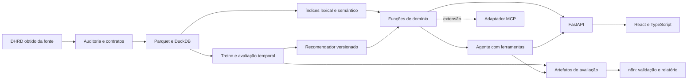

# Arquitetura e evolução

Produto atual: React/TypeScript servido pelo FastAPI, com o mesmo catálogo SQLite usado pelas ferramentas. Descoberta aplica glossário PT/EN explícito. O assistente usa uma chamada estruturada ao Qwen local via llama.cpp, valida um plano limitado e executa busca ou recomendação somente leitura. A resposta factual é montada pelos campos reais, sem geração livre de itens. O artefato de recomendação foi ajustado até o dia 61 e sua origem é conferida contra a do catálogo. A automação n8n consulta resultados versionados e produz Markdown. [Guia e limites](PRODUCT_GUIDE.md).

Dados e modelos: auditoria oficial, preparação de Singapura em SQLite, contexto/quarentena, validação de três recomendadores, FTS5/BM25 e API FastAPI. A validação interna oficial usou 175.358 clientes. Embeddings E5 via ONNX e busca híbrida RRF permanecem em piloto de 10.000 produtos, separados da busca do produto. Fixtures sintéticas existem somente em testes.

Origem: a distribuição oficial completa foi recebida, verificada e auditada em 7/11/2026. `official-source-selection-v1.json` registra os papéis dos quinze arquivos. O novo adaptador lê os originais com teste oficial fisicamente separado. O adaptador histórico continua disponível para reproduzir o Experimento 001. [Migração](OFFICIAL_DATA_MIGRATION.md) e [Experimento 002](EXPERIMENT_002.md).

Fluxo executável atual: CSVs reais fixados por SHA-256 → normalização e quarentena por pedido → SQLite somente leitura para análise → perfis de treino congelados → popularidade/repetição/cosseno por cesta → relatório de validação. Contextos preservam geohash, rede e dia da semana para próximas etapas; ainda não são filtros de candidatos. SQLite foi escolhido para integridade e transações sem dependência de execução adicional; a arquitetura abaixo permanece a visão de evolução.

Python para dados e modelos; DuckDB/Parquet são opções futuras; FastAPI/Pydantic já servem os contratos de catálogo. React/TypeScript e tokens CSS permanecem previstos para interface. O diagrama mostra a evolução proposta, incluindo partes futuras. As dependências de API e testes estão fixadas em `requirements-api.lock` como constraints de versões, sem hashes de distribuição.

A API compartilha funções de domínio com a CLI, abre conexões SQLite somente leitura por operação e serve busca, detalhe, culinárias e procedência. Validação rejeita parâmetros desconhecidos, limites inválidos e valores de preço não finitos. Base ausente, inválida ou sintética retorna 503. A prontidão verifica estrutura e metadados declarados, sem recalcular todo o hash por requisição. Logs locais omitem texto da busca, com IDs de requisição e duração. [Execução e limites](../apps/api/README.md).

Contratos candidatos: `search_catalog(query, filters, limit)`, `recommend(profile_id, filters, limit)`, `get_item(item_id)`, `get_evaluation(run_id)`. Saídas terão IDs, metadados, origem, versão e avisos de cobertura. Nunca aceitar SQL, código arbitrário ou URLs fornecidas pelo LLM para execução.

Separar os modelos de recuperação/ranking do modelo de linguagem. A interface consulta o mesmo serviço usado pelo agente, permitindo comparar filtros convencionais com conversa. Pontuação de ranking não será apresentada como probabilidade de satisfação.

Registrar run_id, versões, ferramenta, duração, tokens/custo quando disponíveis e erros. Remover credenciais e limitar persistência do conteúdo de conversa. Incluir modo sem LLM para falhas ou orçamento esgotado. Resultados sintéticos de desenvolvimento serão identificados e separados dos resultados com DHRD.
