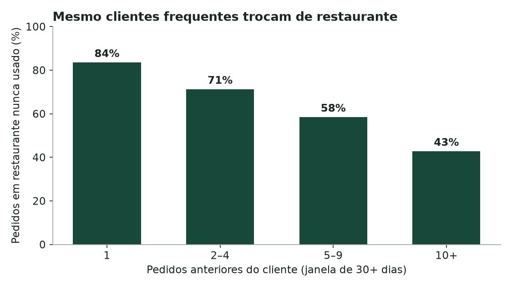
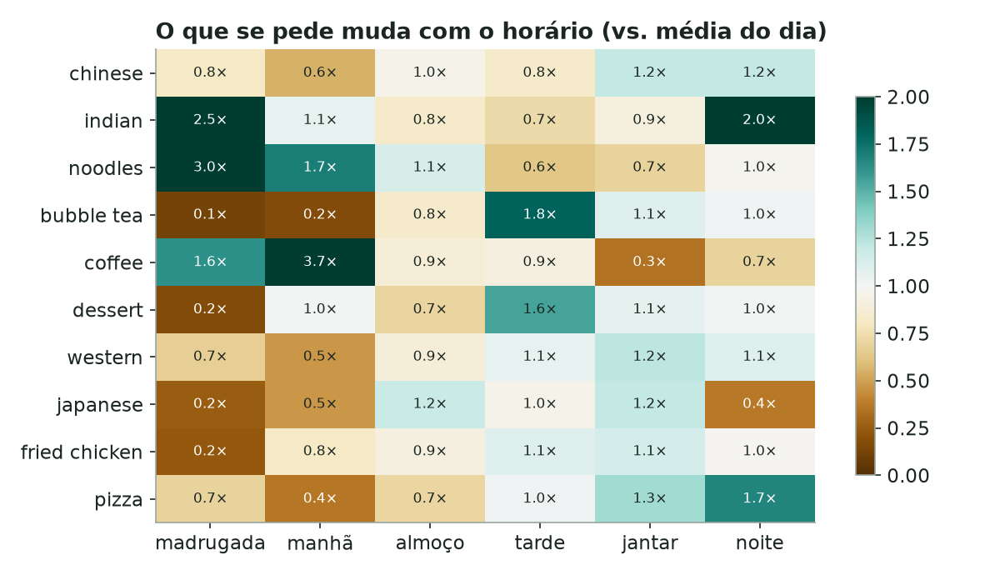
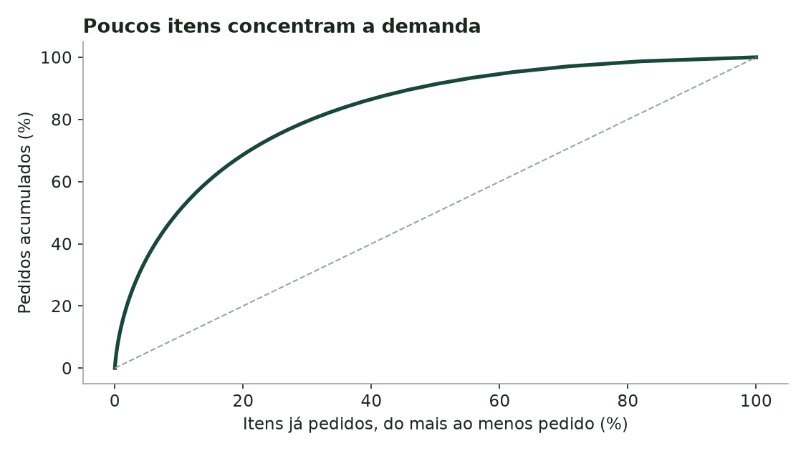
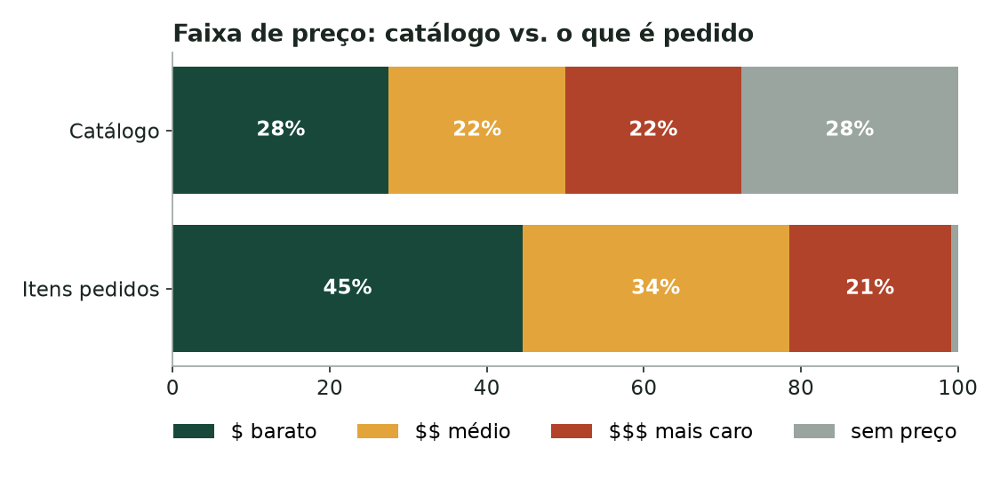

# Análise de negócio: como as pessoas escolhem comida

Pergunta: **quando alguém abre o app de delivery, o que deveria ver?** Antes de
escolher um modelo, olhei como 476 mil clientes de Singapura de fato pediram em
76 dias. São 1.709.379 pedidos reais do [DHRD](https://github.com/deliveryhero/dh-reco-dataset),
com procedência verificada por hash.

Tudo aqui sai de [`analysis/business_analysis.py`](../analysis/business_analysis.py),
e cada número está em [`business-analysis-v1.json`](../evaluations/results/business-analysis-v1.json).
O arquivo só cobre 76 dias e nada antes do dia 0 é conhecido. Por isso, as
perguntas sobre histórico usam apenas pedidos a partir do dia 30, e "cliente
novo" significa "sem pedidos nos 30 dias anteriores".

## Resumo

| # | Achado | Número | O que o produto faz com isso |
| --- | --- | --- | --- |
| 1 | A maioria dos pedidos de quem já é cliente é **exploração** | **63%** vão a um restaurante que a pessoa nunca usou | Recomendar só "peça de novo" atende a minoria; o produto precisa ajudar a descobrir |
| 2 | **A demanda é local e não tem campeões** | 68% dos pedidos são de restaurantes da própria região; os 10 restaurantes mais pedidos da cidade somam só 0,37% dos pedidos, e saíram do topo durante o período | Um ranking da cidade quase não serve; o da região serve |
| 3 | **O horário muda o que se pede** | Café sai **3,7×** mais de manhã; noodles 3,0× de madrugada; bubble tea 1,8× à tarde | A sugestão depende da hora |
| 4 | **Cliente novo é frágil** | **58%** dos novos não voltam em 30 dias; 41% de todos os clientes pediram uma única vez | Para quem não tem histórico, só região e horário estão disponíveis |
| 5 | **Cauda longa** | **77%** do catálogo nunca foi pedido; 10% dos itens pedidos somam metade da demanda | Busca e recomendação precisam ir além do topo, mas com evidência |
| 6 | **Preço importa, e item sem preço não vende** | Entre itens pedidos com preço, 45% são da faixa barata (contra 38% no catálogo); itens sem preço são 28% do catálogo, mas 0,9% do que é pedido | Filtro "barato" por culinária; itens com preço vêm primeiro em empates |

## 1. Exploração é a regra, não a exceção

Dos 853.838 pedidos de clientes que já tinham pedido antes, **62,7% foram para
um restaurante que a pessoa nunca tinha usado**. Contando por rede (marca), a
fatia ainda é 61,0%, então não é efeito de filial. A fatia cai com o histórico
e continua alta: **43% mesmo para quem já fez 10 pedidos ou mais**. No nível de
item, só 22,9% dos itens pedidos já tinham sido comprados pela pessoa.

Isso explica um resultado anterior: na validação temporal (protocolo v2), o
melhor modelo era "repetir o que a pessoa já pediu", com Recall@10 de 14%. Ele
vence porque o resto é difícil de prever, não porque as pessoas só repetem. A
maior parte da demanda é descoberta, e é ela que o app precisa servir.

## 2. A demanda é local e não tem campeões

68,1% dos pedidos saem de um restaurante na mesma célula geográfica do cliente
(geohash de cerca de 5 km).

Ao mesmo tempo, **a demanda entre restaurantes é plana**:
- **Cidade:** os 10 restaurantes mais pedidos de Singapura somam só **0,37%** dos
  pedidos, de 626 a 645 pedidos cada em 76 dias. Contagens tão parecidas podem
  ser efeito da amostragem do DHRD; é hipótese, não fato.
- **Regiões:** comparei o top-20 de cada uma das 24 regiões com mais de 5.000
  pedidos com o top-20 da cidade. A sobreposição mediana é 0%. Isso diz menos
  sobre "gosto local" e mais sobre a falta de restaurantes dominantes.

**O topo da cidade também envelhece.** Esses 10 restaurantes caem de 0,47% dos
pedidos nos dias 0–20 para 0,15% nos dias 62–75. Três deles pararam de receber
pedidos nos dias 49, 54 e 56, e nenhum está no top-10 das duas últimas semanas.
No teste oficial, quase não recebem pedidos.

**Consequência para qualquer comparação:** "mais pedidos da cidade em todo o
período" é uma referência fraca demais, porque acerta menos que um sorteio.
O experimento usa como referência justa os mais pedidos **das últimas duas
semanas** e informa também o acaso.

## 3. O horário muda o que se pede

O jantar (17–20 h) concentra 36,5% dos pedidos e o almoço (11–13 h), 28,1%. O
que se pede muda bastante entre faixas: café tem 3,7× sua participação média de
manhã, noodles e comida indiana dominam a madrugada, e bubble tea e sobremesa
sobem à tarde. Recomendação sem horário ignora um sinal que existe em todo pedido.

## 4. O cliente novo

41,5% dos clientes fizeram um único pedido no período, e os clientes com 5 ou
mais pedidos respondem por 61% do volume. Entre os 80.675 clientes cujo
primeiro pedido caiu nos dias 30–45, **só 42,4% pediram de novo em até 30
dias**. A primeira experiência pesa, e é justamente quando o app não sabe nada
sobre a pessoa além de **onde** e **quando** ela está pedindo.

## 5. Cauda longa

Do 1.066.840 itens do catálogo, 242.545 (22,7%) foram pedidos pelo menos uma vez.
Entre eles, 1% concentra 13,5% da demanda e 10% concentra metade. Restaurantes
são menos concentrados: os 10% mais pedidos somam 24% dos pedidos.

## 6. Preço

O DHRD não publica moeda: o preço é normalizado em uma escala não divulgada.
Por isso, o Mesa mostra **a posição do item dentro da própria culinária** (tercis
$, $$, $$$), que continua válida para qualquer normalização que preserve a ordem.
Detalhes em [ARCHITECTURE.md](ARCHITECTURE.md#preço-em-faixas).

- Considerando apenas itens com preço, o catálogo se divide em 38% / 31% / 31%
  ($ / $$ / $$$), e os itens pedidos em **45% / 34% / 21%**. Dentro de cada
  culinária, o mais barato é escolhido com mais frequência.
- 27,6% do catálogo registra preço 0 (sem preço), e esses itens são só **0,9%**
  do que é pedido. Na prática, são itens inativos ou complementos. O Mesa os
  rotula "preço não informado", nunca os casa com um filtro de preço e os põe
  depois dos itens com preço quando a relevância empata.

## Do achado ao modelo

Os achados 1 a 4 viraram uma hipótese testável: **para decidir o que mostrar,
região e horário valem mais que a popularidade da cidade, e um ranker
que combine histórico e contexto supera cada sinal isolado**. O teste, feito com o
protocolo congelado antes de rodar e avaliado uma única vez no teste oficial do
DHRD, está no [experimento de descoberta](EXPERIMENT_DISCOVERY.md).

## Limites

São dados observacionais: as fatias descrevem comportamento e não provam
causas. Não há dados de impressões, então não dá para saber o que as pessoas
viram e não pediram. Os 76 dias não incluem sazonalidade longa. O geohash é a
região anonimizada do pedido, não um endereço.
